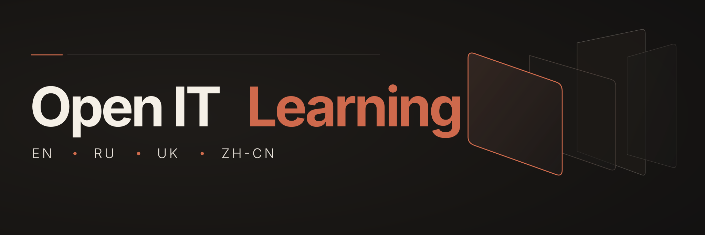

Free IT courses with documented official outcomes, plus reusable tools for learning and research.

[Catalog](catalog/README.md) · [Prompts](prompts/README.md) · [Skills](skills/README.md) · [Wiki](https://github.com/effexorxruser/open-it-learning/wiki) · [Contribute](CONTRIBUTING.md)

**Languages:** English · [Русский](#русский) · [Українська](#українська) · [简体中文](#简体中文)

> **Catalog status:** 11 source-reviewed courses across CS50, OpenLearn and freeCodeCamp, with 15 typed official outcomes and course-linked benefits. [Browse the verified index](catalog/verified/README.md).

## Find and verify

The catalog accepts free IT courses with a documented, obtainable official outcome: a certificate, badge, diploma, award, participation record or course-linked benefit. Learning is free; any separate outcome or exam fee must be disclosed.

1. Browse the [catalog](catalog/README.md) and check the provider's official sources and conditions.
2. Use the [course verification prompt](prompts/verify-course.md) or [Course Verifier skill](skills/course-verifier/SKILL.md) to research a candidate.
3. [Suggest a course](https://github.com/effexorxruser/open-it-learning/issues/new/choose) with official links, short excerpts, the check date, costs and eligibility. Incomplete claims remain under review.

A badge is not automatically a professional credential, a provider diploma does not imply academic accreditation, and a voucher does not prove an exam pass.

Read the [catalog policy](docs/CATALOG_POLICY.md) for admission and evidence requirements.

## Explore

- [Prompts](prompts/README.md) — course verification and learning paths.
- [Skills](skills/README.md) — reusable instructions for course research.
- [Research journal](journal/README.md) — dated research notes, including candidates still under review.
- [Wiki](https://github.com/effexorxruser/open-it-learning/wiki) · [Wiki publication](docs/WIKI.md) — guides and publication instructions.
- [Integrations](integrations/README.md) · [Roadmap](docs/ROADMAP.md) — ideas and future work, including a possible MCP interface.

## Contribute

Share official sources, report changed conditions or improve the learning tools. See [contributing guidelines](CONTRIBUTING.md). No project license has been selected yet.

## Русский

RU — описание проекта и начало работы

Open IT Learning — публичный каталог бесплатных IT-курсов с официальными результатами: сертификатами, бейджами, дипломами, грамотами, наградами, подтверждениями участия и бонусами организатора.

**В каталоге 11 проверенных курсов и 15 отдельно описанных результатов:** программы CS50, OpenLearn и freeCodeCamp. Среди результатов — бесплатные сертификаты, бейджи, подтверждения прохождения и CPD-баллы (не академические кредиты). [Каталог](catalog/verified/README.md) и [журнал исследований](journal/README.md) содержат условия и источники.

### Найти и проверить

1. Откройте [каталог](catalog/README.md) и изучите официальные источники и условия курса.
2. Используйте [промпт проверки на русском](prompts/verify-course.ru.md) или [Course Verifier](skills/course-verifier/SKILL.md) для исследования кандидата.
3. [Предложите курс](https://github.com/effexorxruser/open-it-learning/issues/new/choose), приложив официальные ссылки, короткие цитаты, дату проверки, требования и стоимость.

Обучение должно быть бесплатным; стоимость выдачи результата и экзамена указываем отдельно. Официальный источник должен подтверждать связь результата с конкретным курсом и условия его получения. Неизвестные существенные условия препятствуют публикации. Бейдж не равен профессиональному сертификату, диплом провайдера не обязательно имеет академическую аккредитацию, а ваучер не подтверждает сдачу экзамена. Подробнее — в [политике каталога](docs/CATALOG_POLICY.md).

### Инструменты и участие

[Промпты](prompts/README.md) помогают проверять курсы и планировать обучение; [скиллы](skills/README.md) содержат переносимые инструкции. [Wiki](https://github.com/effexorxruser/open-it-learning/wiki) объясняет методику. [Интеграции](integrations/README.md), включая возможный MCP-интерфейс, пока являются планами.

Предлагайте источники, исправляйте устаревшие условия и улучшайте инструменты по [правилам участия](CONTRIBUTING.md). Лицензия проекта пока не выбрана.

## Українська

UK — опис проєкту та початок роботи

Open IT Learning — публічний каталог безкоштовних IT-курсів з офіційними результатами: сертифікатами, бейджами, дипломами, грамотами, нагородами, підтвердженнями участі та бонусами організатора.

**У каталозі 11 перевірених курсів і 15 окремо описаних результатів:** програми CS50, OpenLearn та freeCodeCamp. Результати включають безкоштовні сертифікати, бейджі, підтвердження участі й бали CPD (не академічні кредити). [Каталог](catalog/verified/README.md) і [журнал](journal/README.md) містять умови та джерела.

### Знайти та перевірити

1. Відкрийте [каталог](catalog/README.md) і прочитайте офіційні джерела та умови курсу.
2. Скористайтеся [промптом перевірки англійською](prompts/verify-course.md) або [Course Verifier](skills/course-verifier/SKILL.md) для дослідження кандидата.
3. [Запропонуйте курс](https://github.com/effexorxruser/open-it-learning/issues/new/choose), додавши офіційні посилання, короткі цитати, дату перевірки, вимоги й вартість.

Навчання має бути безкоштовним; вартість видачі результату та іспиту зазначаємо окремо. Офіційне джерело має підтверджувати зв'язок результату з конкретним курсом і умови його отримання. Невідомі істотні умови перешкоджають публікації. Бейдж не дорівнює професійному сертифікату, диплом провайдера не обов'язково має академічну акредитацію, а ваучер не підтверджує складання іспиту. Докладніше — у [політиці каталогу](docs/CATALOG_POLICY.md).

### Інструменти та участь

[Промпти](prompts/README.md) допомагають перевіряти курси та планувати навчання; [скіли](skills/README.md) містять переносні інструкції. [Wiki](https://github.com/effexorxruser/open-it-learning/wiki) пояснює методику. [Інтеграції](integrations/README.md), зокрема можливий MCP-інтерфейс, наразі є планами.

Пропонуйте джерела, виправляйте застарілі умови й удосконалюйте інструменти за [правилами участі](CONTRIBUTING.md). Ліцензію проєкту поки не обрано.

## 简体中文

ZH-CN — 项目介绍与使用方法

Open IT Learning 是免费 IT 课程的公共目录，关注官方学习成果：证书、徽章、文凭、奖状、奖项、参与记录及提供方的课程相关福利。

**课程目录目前收录 11 门经来源核实的课程，分别记录 15 项官方成果及课程相关福利：** 涵盖 CS50、OpenLearn 和 freeCodeCamp。成果包括免费结业证书、数字徽章、参与记录及 CPD 继续职业发展积分（不等同于大学学分）。请查阅[课程目录](catalog/verified/README.md)及[研究日志](journal/README.md)了解具体要求与证据。

### 查找与核实

1. 打开[课程目录](catalog/README.md)，阅读提供方的官方来源与课程条件。
2. 使用[英文核实提示词](prompts/verify-course.md)或 [Course Verifier](skills/course-verifier/SKILL.md) 调查候选课程。
3. [推荐课程](https://github.com/effexorxruser/open-it-learning/issues/new/choose)，附上官方链接、简短引文、核实日期、获取要求与费用。

学习内容必须免费；成果颁发及考试的单独费用应明确标注。官方来源须证明该成果适用于这门课程，并说明如何获得。重要条件不明的记录不能进入已核实目录。徽章不等同于专业资格证书，提供方颁发的文凭不一定具有学术认证，考试代金券也不代表通过考试。详见[收录规则](docs/CATALOG_POLICY.md)。

### 工具与参与

[提示词](prompts/README.md)用于核实课程及规划学习；[技能](skills/README.md)提供可复用的操作指南。[Wiki](https://github.com/effexorxruser/open-it-learning/wiki)解释核实方法。[集成](integrations/README.md)（包括可能的 MCP 接口）仍处于规划阶段。

欢迎按照[贡献指南](CONTRIBUTING.md)提供官方来源、报告条件变化并改进工具。项目尚未选定许可证。

