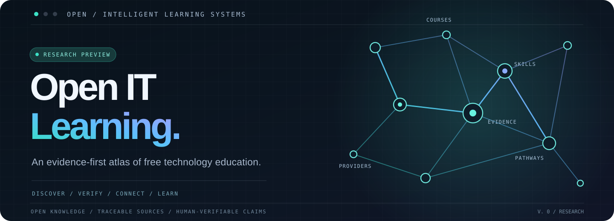

 

**A curated, source-checked collection of free IT courses with documented certificates and credentials.**

[**Browse courses**](catalog/README.md) · [**Use prompts**](prompts/README.md) · [**Explore skills**](skills/README.md) · [**Contribute**](CONTRIBUTING.md)

[English](README.md) · [Русский](docs/README.ru.md)

---

## Learn something. Have something to show for it.

Finding free IT education is easy. Finding a course that actually leads to a **documented, obtainable credential** is harder.

**Open IT Learning** is being built as a practical, curated repository that answers three questions before recommending a course:

**01 — Can I learn for free?** We distinguish free enrollment and course access from trials, subscriptions and paid exams.

**02 — What can I earn?** We document the actual certificate or digital credential, how to obtain it, and whether any fee applies.

**03 — Where is the proof?** We link to the provider's official pages and record when the information was checked.

No invented course links. No equating a badge with a professional certification. No claiming that a certificate exists simply because a course is free.

## What you'll find here

| Directory | What it contains |
| :--- | :--- |
| **[catalog/](catalog/README.md)** | Courses admitted only after official evidence confirms the learning opportunity **and** obtainable credential. |
| **[prompts/](prompts/README.md)** | Copy-ready prompts for course discovery, verification and personalized learning paths. |
| **[skills/](skills/README.md)** | Reusable, transparent agent workflows for checking course pages and evidence. |
| **[integrations/](integrations/README.md)** | Ideas and interface contracts for later tools such as an MCP server; not a live integration yet. |
| **[journal/](journal/README.md)** | Optional field notes on course research, curation and agent-assisted parsing — not the internal development environment. |
| **[docs/](docs/CATALOG_POLICY.md)** | Verification rules, proposed record format and contribution guidance. |

## Course catalog

> **Catalog status:** no certificate-verified records have been published yet. We prefer an honest empty index over a directory of uncertain claims.

The intended catalog is structured for real decisions, not marketing claims:

| Data | Required proof |
| :--- | :--- |
| Provider and course | Official page and canonical link |
| Course access | Official evidence that the learning content is available free of charge |
| Credential | Official evidence that a certificate or qualifying digital credential **can be earned** |
| Conditions | Completion, assessment and eligibility requirements, or a clearly documented unresolved limitation |
| Cost | Course fees and credential/exam fees shown separately |
| Last reviewed | Date and source excerpts or references |

A free course with **unverified certificate availability** does **not** qualify for the verified index. A paid exam is not described as a free certificate.

Read the [catalog acceptance policy](docs/CATALOG_POLICY.md) and the [course record format](docs/DATA_CONTRACT.md).

## Ready-to-use resources

**Research prompt** — [Verify a course and its credential](prompts/verify-course.md). A structured, source-first prompt for a browsing-capable assistant.

**Planning prompt** — [Build a certificate-aware learning path](prompts/learning-path.md). Choose courses by goals, prerequisites, time and credential cost.

**Agent skill** — [Course Verifier](skills/course-verifier/SKILL.md). A reviewable workflow with explicit admission criteria and evidence checks.

These are **templates and workflow instructions**, not claims that an agent or MCP server is hosted by this repository.

## A small example of why verification matters

A research snapshot of Cisco's *Introduction to Cybersecurity* showed an official page describing free access, approximately six hours of learning, and badges. However, the same research did **not** establish the availability and conditions of a course certificate.

**Result: not eligible for the verified catalog yet.** The distinction between “badges shown” and “certificate independently confirmed” is exactly why this project exists. See the [research note](journal/2026-10-28-cisco-introduction-to-cybersecurity.md).

## Built for useful contributions

If you know a free IT course with a documented certificate, [suggest it](https://github.com/effexorxruser/open-it-learning/issues/new/choose) with its official source. If a published record becomes inaccurate, [flag it](https://github.com/effexorxruser/open-it-learning/issues/new/choose). Contributions are reviewed against the same evidence policy.

We are also collecting reusable prompt patterns and workflow ideas — each should solve a concrete learning or verification problem.

## Roadmap

1. **Verified foundation:** publish the first genuinely confirmed records and a versioned data contract.
2. **Practical tooling:** expand prompts, skills and quality checks around the catalog.
3. **Learning routes:** group courses by skills, prerequisite chains and goals.
4. **Integrations:** explore exports, search tools and a potential MCP interface without requiring anyone to run the maintainer's research infrastructure.

See [ROADMAP](docs/ROADMAP.md).

---

Open IT Learning is an independent, early-stage community resource. Provider names are used for reference; no affiliation or endorsement is implied. The private tooling used to research and maintain the catalog is separate from this public repository.
