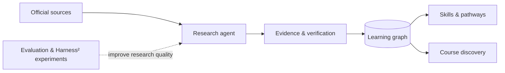

<div align="center">
  

  <br />

  **Find the learning opportunity. Follow the evidence. Build your own path.**

  An open research initiative to discover, verify, and connect free IT learning opportunities.

  <br />

  [**Vision**](#the-idea) · [**How it works**](#how-it-works) · [**Data principles**](#evidence-before-claims) · [**Architecture**](docs/ARCHITECTURE.md) · [**Roadmap**](docs/ROADMAP.md) · [**Contribute**](CONTRIBUTING.md)

  [English](README.md) · [Русский](docs/README.ru.md)

  <br />

  
  
  
</div>

---

> [!IMPORTANT]
> **Research preview, not a released platform.** This is the public home for Open IT Learning. The research-agent prototype and Harness² experiments are being developed separately. No production catalog, public API, continuously verified course dataset, or downloadable application is published in this repository yet. The architecture below describes the intended system.

## The idea

There are thousands of ways to learn technology online. The difficult part isn't finding another course listing. It's answering the questions that actually matter:

- Is the course **really free**, or is only the introduction free?
- Does it award a **certificate, a digital badge, or neither**? Are assessments or credentials paid?
- Is the link **official, working, and current**?
- Which **skills** does it teach, and where can those skills take you next?
- Can every important claim be **traced to a source**?

**Open IT Learning** aims to turn scattered learning opportunities into a connected, verifiable map of courses, skills, providers, credentials, and pathways.

## From links to a learning graph

<div align="center">



</div>

| Layer | Responsibility |
| :--- | :--- |
| **Discover** | Find course candidates and their official, canonical pages. |
| **Read** | Use web requests and browser automation when a page requires JavaScript. |
| **Verify** | Separate source-backed facts from claims that remain uncertain. |
| **Connect** | Model relationships between courses, skills, providers, badges, and credentials. |
| **Improve** | Evaluate research traces and test changes to the agent's instructions and tools. |

The goal is not to collect the most links. It's to collect **claims you can inspect**.

## Evidence before claims

Every verified fact should have a source and a verification date. A course can be free while its certificate is paid; a badge is not automatically a professional certification.

| Question | What we store |
| :--- | :--- |
| **Where is it?** | Canonical course URL, publisher, redirects and source location. |
| **What does it cost?** | Learning price separately from assessment and credential costs. |
| **What do you earn?** | Certificate, badge, or other credential — with conditions and evidence. |
| **What do you learn?** | Skills, prerequisites, language, level and estimated duration, where supported. |
| **Can we trust it?** | Supporting excerpts, source URLs, verification date and confidence/status. |

Unverifiable is not the same as false. The intended workflow preserves `unverified`, `stale`, and `unavailable` states rather than guessing.

See the proposed [data contract](docs/DATA_CONTRACT.md) for details.

## How it works

The research workflow is being developed around a **tool-using agent** and a reproducible evaluation loop:

```text
Research question
    |
    v
Discover official course page
    |
    v
Read HTML / render with Playwright
    |
    v
Extract claims + evidence
    |
    v
Validate links, quotes and semantics
    |
    v
Stage structured candidates
    |
    v
Human review / quality gates
    |
    v
Learning graph
```

We are also investigating **Harness²** by Google Research for systematic improvement of research-agent behavior: instructions, tool use, failure recovery and evaluation. This is about optimizing the **agent harness**, not training model weights.

**Current development separation:** Codex is used for engineering and orchestration; an experimental research solver uses a separately routed model provider. Model availability, reliable billing, judge independence, and production readiness are all subject to verification.

Read [architecture and boundaries](docs/ARCHITECTURE.md).

## Project status

| Area | Status |
| :--- | :--- |
| Public project identity and specifications | **Available here** |
| Local research-solver prototype | **Experimental, maintained separately** |
| Playwright / dynamic-page investigation | **Prototype testing** |
| Harness² research benchmark | **Experimental, not published here** |
| Public verified course catalog | **Not released** |
| Public graph, website, and API | **Planned** |

This table intentionally avoids implying that work happening in a local research lab is already available in this GitHub repository.

## What comes next

**01 / Foundations** — publish a data schema, contribution rules and a small evidence-backed sample.

**02 / Research quality** — establish reproducible test cases, source verification and an auditable baseline.

**03 / Learning graph** — connect verified learning opportunities to skills and structured pathways.

**04 / Community platform** — enable discovery, submissions, corrections and ongoing re-verification.

Track the full [roadmap](docs/ROADMAP.md).

## Contributing

The project is early, and thoughtful contributions are welcome: primary-source course suggestions, evidence-model feedback, data-quality cases, accessibility ideas, and research evaluation proposals.

Start with [CONTRIBUTING.md](CONTRIBUTING.md). Please do **not** submit unverified course lists as verified data.

## Principles

**Open by design.** Educational opportunities should be accessible and understandable.

**Evidence over volume.** Ten supported facts beat a thousand unverified links.

**Honest uncertainty.** Missing proof stays missing proof.

**Reproducible research.** Decisions, sources and evaluation criteria should be inspectable.

**Humans remain in control.** Research automation proposes; verification gates decide what is published.

---

<div align="center">
  <sub>OPEN IT LEARNING · An open map of opportunities, built on verifiable knowledge.</sub>
  <br />
  <sub>Early-stage research initiative · Not affiliated with or endorsed by any course provider or Google Research.</sub>
</div>
