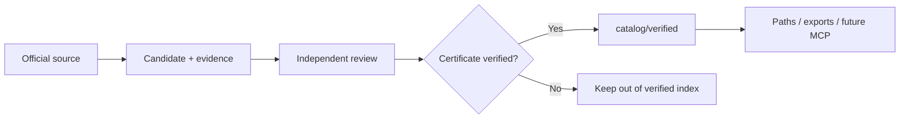

# Public repository structure

[← Home](../README.md) · [Catalog policy](CATALOG_POLICY.md) · [Roadmap](ROADMAP.md)

This repository is **a course library and a collection of reusable learning resources**. It is **not** a deployment of the maintainer's research agent, Harness², model routers, browsers, or internal experiment infrastructure.

## Directory map

```text
open-it-learning/
├── catalog/
│   ├── README.md          Verified-course index
│   ├── verified/          Approved, source-reviewed records
│   └── schema/            Data format and validation
├── prompts/               Ready-to-copy research and planning prompts
├── skills/                Portable course-verification skills
├── integrations/          Future public interfaces (MCP proposal, exports)
├── journal/               Optional research and curation field notes
├── docs/                  Editorial policy and user documentation
├── assets/                Visual identity
└── .github/               Contribution templates
```

The design optimizes for plain GitHub browsing first: records and methods should be readable without installing an application.

## Course publication flow



The publication gate concerns **certificate availability and conditions**, not whether a browser could load a page.

## Record boundaries

A public record may contain provider, course and certificate data; official evidence URLs; short supporting excerpts; and review dates. It must not contain local browser traces, API keys, account identifiers, authentication cookies, or private experimental data.

The difference between course and credential cost must remain explicit. A badge or achievement icon is not automatically a certificate.

## Ready-to-use tools

Prompts and skills are versioned text files. They can be copied into compatible assistants, reviewed, modified and reused independently of the catalog. An MCP interface is only a proposal until implemented.

## Maintainer workflow is separate

The maintainer may use automated browsing, agents, evaluation suites and private research tools to propose course records. Those are **implementation details of maintenance**, not parts of the public product, installation requirements or source of authority for course claims.

Only approved catalog facts with official evidence should be represented as verified. See [catalog inclusion policy](CATALOG_POLICY.md).
