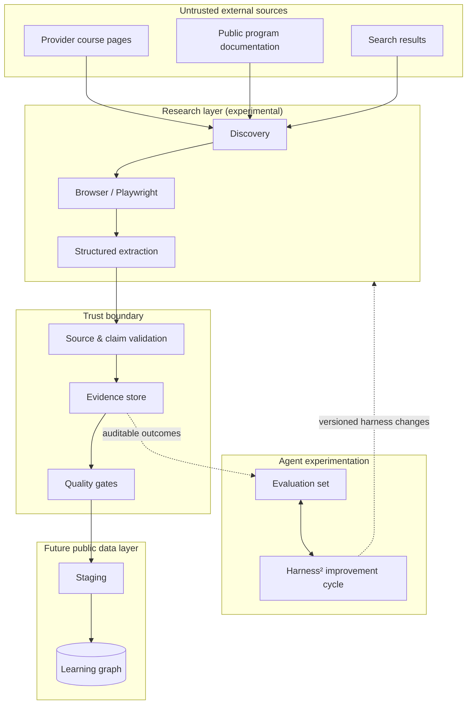

# Architecture / Research system

> **Design document — not a description of a deployed service.**
> The research prototype lives in a separate local development environment. This repository currently publishes the project direction and specifications.

[← Overview](../README.md) · [Data contract](DATA_CONTRACT.md) · [Roadmap](ROADMAP.md)

## System boundaries

## Roles, not interchangeable labels

| Role | Intended responsibility | Boundary |
| --- | --- | --- |
| **Codex / engineer** | Develop code, maintain tools, run controlled experiments | Engineering session, not an automatic claim verifier |
| **Research Solver** | Discover, browse, extract and propose structured course records | Model provider and browser tools are independently configured |
| **Evaluator** | Check source support, schema validity and reproducibility | Deterministic assertions precede model judgment |
| **Judge** | Independently assess ambiguous or semantic quality | Requires validated independent API route |
| **Improver / Harness²** | Propose and compare improvements to agent instructions and tool usage | No silent promotion of untested changes |

The project explores Harness² concepts and real integrations where feasible, not a claim that its stock benchmarks measure education research.

## Research trace

For each run, capture:
1. Task ID, model route, harness version and tool configuration.
2. Discovered candidate URLs and final canonical URLs.
3. Browser interactions, timestamps, redirect chain and bounded diagnostics.
4. Extracted facts and supporting evidence spans.
5. Validation outcomes, contradictions and unresolved fields.
6. Requests, latency, token accounting and *estimated* cost, clearly separated from provider billing.

External page text is **untrusted data**. It must never be promoted into a system instruction or shell command.

## Security constraints

- Public HTTPS sources only, with per-request validation and protections against private-address access and redirect-based SSRF.
- Navigation and browser resource budgets are separate from model request budgets.
- Read-only discovery by default. No automatic logins, submissions, purchases or CAPTCHA bypasses.
- Any necessary API interactions must be limited to supported read-only operations after method and payload validation.
- Provider keys stay outside source code and reports.
- Sensitive headers, cookies, full error bodies and private account data are excluded from shared traces.
- The original Harness² executor sandbox settings require review before running untrusted tasks. Rootless containers alone do not guarantee network isolation.

## Evaluation philosophy

Every change must be compared against a stable baseline on the same tasks. Separate:
- **Schema correctness** (deterministic),
- **URL and source integrity** (network/record validation),
- **Evidence support** (quote and semantic assessment),
- **Result completeness** (task-specific),
- **Efficiency** (time, requests, resources, estimated cost).

Do not train on holdout answers or assume a lower token cost is proof of higher research quality.

## Deployment is not yet defined

The graph database, public API, hosted application, authentication model and update schedule will be selected after a small verified dataset and evaluation benchmark are established. No production infrastructure is implied by this specification.
